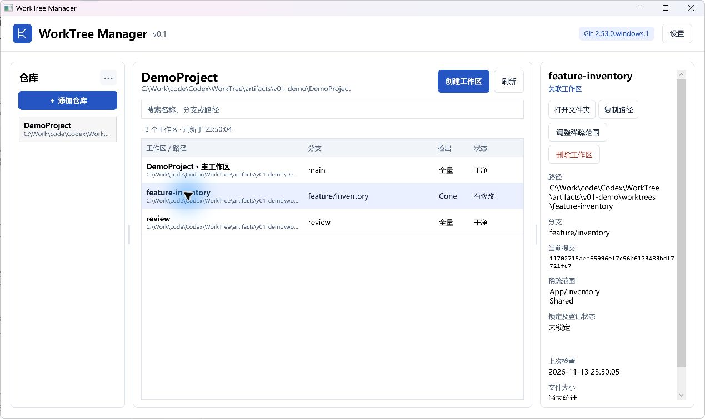
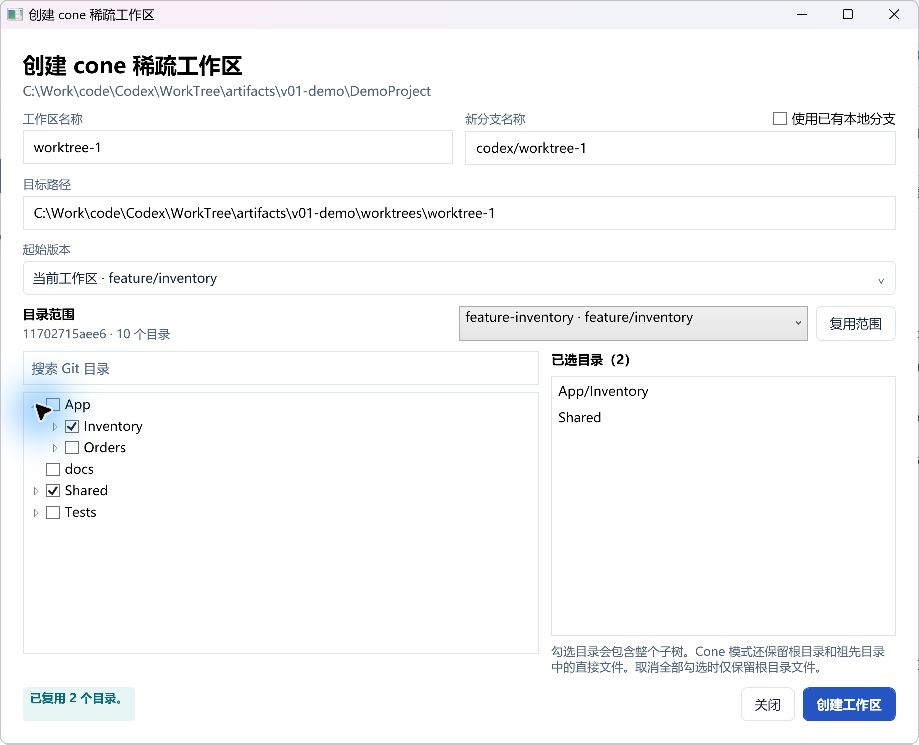
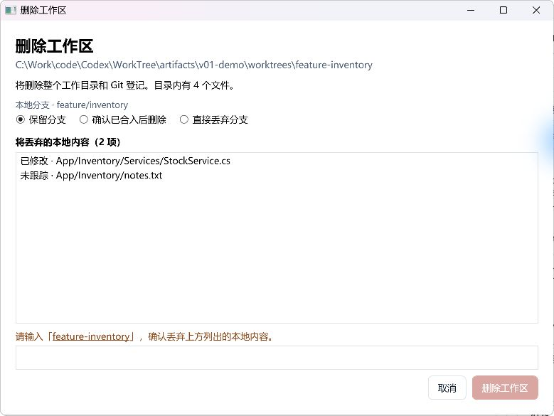

# WorkTree Manager

面向 Windows x64 的本地 Git 工作区管理工具。在一个窗口里查看多个仓库的 worktree，为大仓库按模块创建 cone 稀疏工作区，并在清理前预览影响。

## 下载和启动

1. 安装 [Windows x64 .NET 10 Desktop Runtime](https://dotnet.microsoft.com/zh-cn/download/dotnet/10.0) 和 [Git for Windows 2.43 或更新版本](https://gitforwindows.org/)。
2. 从 [最新发布页](https://github.com/u9-hbzhang/WorkTree-Manager/releases/latest) 下载 `WorkTree-win-x64.zip`，解压到当前用户可写的文件夹，双击 `WorkTree.exe`。便携包依赖本机的 .NET 10 Desktop Runtime。
3. 设置、列表缓存和日志保存在程序旁的 `data` 目录。升级时保留该目录，迁移电脑后可在仓库菜单中选择 **重新定位**。

## 查看和打开工作区



- 点 **添加仓库**，选择本地 Git 仓库、关联 worktree 或其中的目录。按名称、分支或路径搜索，双击行打开文件夹。
- 首次打开仓库时加载列表，之后点 **刷新** 或按 F5 更新。拖动三栏之间的分隔栏可调整宽度。
- 在 **设置** 中指定 Git 路径或添加开发工具。例如为 VS Code 选择 `Code.exe`，将 `--new-window` 和 `{worktree}` 分别填入两行参数。
- 在详情中可按需统计工作文件大小。统计跳过工作区根目录的 `.git`、链接和无法读取的项。

## 创建和调整稀疏工作区



1. 点 **创建工作区**。窗口建议可用的 `worktree-1` 等名称，默认分支是 `codex/名称`，默认位置是与主工作区同级的 `worktrees/名称`。三个字段都可编辑。
2. 打开 **起始版本** 可搜索分支和标签。列表隐藏 `origin/*`，仍可通过 **指定提交或 Git 引用** 输入完整引用。继续旧任务时，勾选 **使用已有本地分支**，选择尚未检出的分支。
3. 展开目录树或搜索目录，勾选要检出的子树。也可选择另一个 cone 工作区并点 **复用范围**。起始提交缺失的目录会显示提示。
4. 要修改现有的关联 cone 工作区，在详情点 **调整稀疏范围**。预览会列出移出的受跟踪文件、将丢弃的本地内容和需要先处理的阻塞项。确认后应用，主工作区保持原有范围。

Cone 模式会保留根目录及所选路径祖先目录中的直接文件。取消全部勾选时仅保留根目录文件。缩小范围时，可以输入工作区名称确认丢弃移出范围内的本地修改、暂存、未跟踪或忽略文件。预览列出的链接、嵌套仓库、子模块和检出冲突等阻塞项需先处理。

创建或调整后会更新对应行。每个仓库在本次运行中首次打开时加载，之后整表只在点击 **刷新** 或按 F5 时更新。从列表移除仓库只移除软件里的记录。

## 删除工作区和清理失效登记



- 在关联工作区详情中点 **删除工作区**，核对路径、文件总数及本地内容。存在修改、暂存、未跟踪或忽略文件时，输入工作区名称后才能确认丢弃。
- 默认保留本地分支。选择 **确认已合入后删除** 时，在预览里选择合入目标并点击 **保存并检查**。通过 Git 的合入检查后即可一起删除。远程分支使用本地已缓存的引用。
- 清理实验工作区时，可选择 **直接丢弃分支**，输入工作区名称确认后一起删除。此方式允许删除含有未合入提交的本地分支，分支独有的提交可能丢失。
- 仓库栏顶部 **⋯ → 清理失效登记** 会预览 Git 在整个仓库中准备清理的登记。磁盘不可访问、路径无法核对或失效登记仍有暂存内容时，先处理提示。清理会保留本地分支。
- 清理成功后只移除对应行。主工作区、锁定工作区，以及包含目录链接、嵌套仓库或已初始化子模块的工作区受到保护。清理操作限定在本机固定磁盘。

## 开发与打包

使用 .NET 10 SDK 和 PowerShell，在项目根目录运行：

```powershell
dotnet build .\WorkTree.slnx
dotnet test .\WorkTree.slnx
.\scripts\Publish-Portable.ps1
```

测试使用临时 Git 仓库。发布脚本生成 `artifacts\WorkTree-win-x64.zip`，其中包含 Windows x64 程序、说明和截图。构建需要 .NET 10 SDK。

## 发布新版本

在要发布的提交上创建并推送版本标签，例如：

```powershell
git tag -a v0.2 -m "WorkTree Manager v0.2"
git push origin v0.2
```

GitHub Actions 会测试标签指向的提交。测试通过后，使用标签设置程序版本，生成不含 .NET 运行时的 ZIP，并发布到对应的 GitHub Release。支持 `v0.2` 和 `v0.2.1` 这类标签。也可以在 **Actions → Release → Run workflow** 手动验证测试和打包，手动运行只执行验证。
